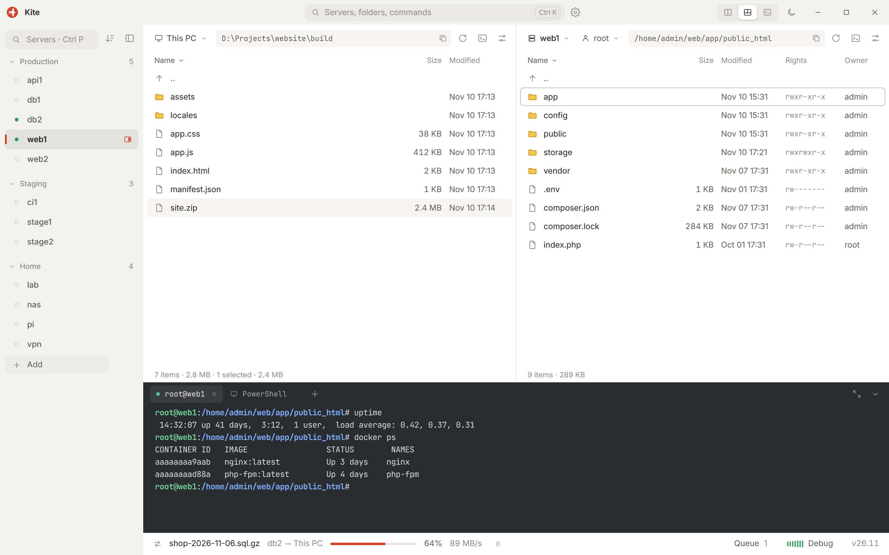

# Kite

**English** · [Русский](README.ru.md)

SSH and SFTP in one window: two file panes and a terminal side by side, for people who keep a lot of servers.

<picture>
  <source media="(prefers-color-scheme: dark)" srcset="docs/screenshot-en-dark.png">
  
</picture>

> **Status:** before the first release. Windows only for now; Linux comes next.

## Install

Download from [Releases](https://github.com/ufee/Kite/releases):

- `Kite-v…-setup.exe` installs for the current user, no administrator rights needed.
- `Kite-v…-portable.zip` runs from any folder. Settings, servers and the session stay in `Kite\data` next to `Kite.exe`; remove that folder and the copy uses the usual per-user folders, like an installed one.

Both use the WebView2 runtime that ships with Windows 10 and 11. Passwords and key passphrases are kept in Windows Credential Manager, host keys in `~/.ssh/known_hosts`, shared with OpenSSH, in both cases.

Until the builds are code-signed, SmartScreen may warn about an unknown publisher: choose **More info**, then **Run anyway**. `SHA256SUMS.txt` in each release lists the checksums of its files.

## Stack

- [Tauri 2](https://tauri.app) shell, Rust core (`src-tauri/`)
- Vue 3 + TypeScript + Vite interface (`ui/`), [xterm.js](https://xtermjs.org) terminal
- Windows first; other platforms later

## Development

Requirements: Node.js 22.12+ and, for the desktop shell, a stable Rust toolchain with the [Tauri prerequisites](https://tauri.app/start/prerequisites/).

```bash
npm install
npm run ui      # interface only, in a browser at http://localhost:5174
npm run dev     # desktop app
npm run check   # type check
npm run build   # release build
```

In the browser the app runs on the mock backend, so everything except window controls works without a server.

A tag `v<version>` (the version lives in `src-tauri/tauri.conf.json` only) builds the installer and the portable archive in GitHub Actions and opens a draft release. See [CONTRIBUTING.md](CONTRIBUTING.md) before sending a change and [SECURITY.md](SECURITY.md) to report a vulnerability.

## License

The source code is released under the [MIT License](LICENSE).

The fonts Inter and JetBrains Mono are under the SIL Open Font License 1.1. Their license texts, together with those of every Rust crate and npm package in the build, are in `THIRD_PARTY_LICENSES.txt` next to the installed app, generated by `scripts/third-party.mjs`.

The name **Kite** and the logo (files in `brand/` and the application icons in `src-tauri/icons/`) are not covered by the MIT License. You may not use them for your own products or forks without permission; please rename and rebrand a fork you distribute.
