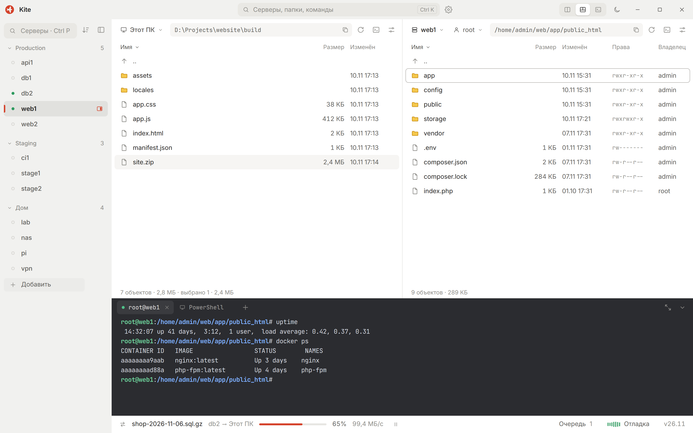

# Kite

[English](README.md) · **Русский**

SSH и SFTP в одном окне: две файловые панели и терминал рядом — для тех, у кого много серверов.

<picture>
  <source media="(prefers-color-scheme: dark)" srcset="docs/screenshot-ru-dark.png">
  
</picture>

> **Статус:** до первого выпуска. Пока только Windows, следующим будет Linux.

## Установка

Скачайте с [Releases](https://github.com/ufee/Kite/releases):

- `Kite-v…-setup.exe` ставит приложение для текущего пользователя, права администратора не нужны.
- `Kite-v…-portable.zip` работает из любой папки. Настройки, серверы и сессия хранятся в `Kite\data` рядом с `Kite.exe`; без этой папки копия пишет в обычные папки пользователя, как установленная.

Обоим нужен WebView2, он есть в Windows 10 и 11. Пароли и парольные фразы ключей в обоих случаях хранятся в диспетчере учётных данных Windows, ключи хостов — в `~/.ssh/known_hosts`, общем с OpenSSH.

Пока сборки не подписаны, SmartScreen может предупредить о неизвестном издателе: «Подробнее», затем «Выполнить в любом случае». В каждом выпуске лежит `SHA256SUMS.txt` с контрольными суммами файлов.

## Стек

- Оболочка [Tauri 2](https://tauri.app), ядро на Rust (`src-tauri/`)
- Интерфейс на Vue 3 + TypeScript + Vite (`ui/`), терминал [xterm.js](https://xtermjs.org)
- Сначала Windows, другие платформы позже

## Разработка

Нужны Node.js 22.12+ и, для десктопной оболочки, стабильный Rust с [зависимостями Tauri](https://tauri.app/start/prerequisites/).

```bash
npm install
npm run ui      # только интерфейс, в браузере на http://localhost:5174
npm run dev     # десктопное приложение
npm run check   # проверка типов
npm run build   # релизная сборка
```

В браузере приложение работает на mock-бэкенде, поэтому без сервера работает всё, кроме управления окном.

Тег `v<версия>` (версия задаётся только в `src-tauri/tauri.conf.json`) собирает установщик и portable-архив в GitHub Actions и открывает черновик выпуска. Перед правкой прочитайте [CONTRIBUTING.md](CONTRIBUTING.md), об уязвимости сообщайте по [SECURITY.md](SECURITY.md).

## Лицензия

Исходный код распространяется по [лицензии MIT](LICENSE).

Шрифты Inter и JetBrains Mono распространяются по SIL Open Font License 1.1. Их лицензии, как и лицензии всех crate Rust и пакетов npm в сборке, лежат в `THIRD_PARTY_LICENSES.txt` рядом с установленным приложением; файл собирает `scripts/third-party.mjs`.

Название **Kite** и логотип (файлы в `brand/` и иконки приложения в `src-tauri/icons/`) под лицензию MIT не подпадают. Использовать их в своих продуктах или форках без разрешения нельзя: если распространяете форк, переименуйте его и смените оформление.
